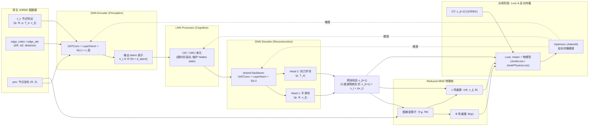

<!-- 封面 -->
# HyPhy-GLNN 进展汇报

- Tokamak 破裂预测 & 热猝灭建模
- 基于 JOREK 的 GNN-LNN-GNN surrogate(代理模型)
- 日期：2026-03-02

---

## 1. 问题背景与目标

- JOREK：求解 Reduced MHD，用于高保真 tokamak 破裂与热猝灭模拟。
- 计算代价：单条长序列通常需要 $\mathcal{O}(10^2)$ CPU 小时。
- 需求：
  - 长时间序列预测 (long-horizon rollout)，保持物理一致性；
  - 可用于快速扫描工况与辅助控制设计。
- HyPhy-GLNN 目标：
  - 在 **原生 JOREK 有限元网格** 上学习 surrogate；
  - 输出 5 个主变量 $(\psi, \Phi, \rho, T_e, v_{\parallel})$ 的时空演化；
  - 提供破裂相关诊断与物理残差评估。

---

## 2. 数据与归一化策略

- 数据来源：JOREK HDF5 输出 (BEST / ITER_SPI_fast / EHL-2 等 case)。
- 图构建 (No Rasterization)：
  - 节点：Bezier 有限元节点坐标 $(R, Z)$；
  - 边：基于 `contain_node` / `vertex` / `neighbours` 构造单元内完全图或单元邻接；
  - 边属性：$(\Delta R, \Delta Z, \lVert \Delta \mathbf{x} \rVert)$，用于 GNN 与梯度算子。
- 时间序列：
  - `JorekSequenceDataset` 按文件名中的时间索引排序；
  - 使用滑动窗口生成长度为 `SEQ_LEN` 的序列 `[G_t, ..., G_{t+L-1}]`。

---

## 2. 数据与归一化策略（续）

- 全局归一化：
  - 特征顺序固定为 $[\psi, \Phi, \rho, T_e, v_{\parallel}]$；
  - $\rho, T_e$：先做 $y = \log(1 + \max(x, 0))$；
  - 然后对 5 个通道分别做全局 Z-score 标准化 (mean/std 保存在 checkpoint 中)。

---

## 3. 模型结构概览 (GNN-LNN-GNN)

- **GNN Encoder (Perception)**
  - 多层 GATConv + LayerNorm + SiLU；
  - 使用 edge_attr=$(\Delta R, \Delta Z)$ 打破纯拓扑对称性；
  - 映射：$[N, 5] \to [N, d_\text{latent}]$。
- **LNN Processor (Cognition)**
  - CfC (若缺失则回退 GRU)；
  - 在 PyG 扁平 batch 上按节点还原 batch 维度；
  - 通过 hidden state 实现跨时间的记忆，支持 warm-up + autoregressive rollout。

---

## 3. 模型结构概览 (GNN-LNN-GNN)（续）

- **GNN Decoder (Reconstruction + Disruption Head)**
  - 共享特征提取 backbone；
  - 双头解码：平滑场 $(\psi, \Phi, v_{\parallel})$ 与热力学场 $(\rho, T_e)$；
  - 图级破裂概率 head (global mean pooling + MLP)（未启用）。

- **物理核 (Reduced MHD)**
  - $\mathbf{B} = \dfrac{F_0}{R} \hat{\phi} + \dfrac{1}{R} \nabla \psi \times \hat{\phi}$；
  - $\mathbf{v} = -R \nabla \Phi \times \hat{\phi} + v_{\parallel} \mathbf{B}$；
  - 在非结构化网格上通过图梯度算子实现可微分计算。

---

---

## 4. 损失函数与物理约束

- **JorekLoss (破裂预测任务，初版)**
  - 回归：Huber Loss (每节点、每通道)，带通道权重，缓解不同量级；
  - 分类：破裂 logits 上的 BCEWithLogitsLoss；
  - 边界项：利用 `boundary` + `psi_axis` / `psi_bnd`，对边界 \($\psi$) 给更高权重；
  - 支持空间节点权重 (磁轴、台基区域可加权)。
- **JorekPhysicsLoss (插值 / 残差任务，当前)**
  - 内部复用 denormalize 逻辑：撤销 Z-score 和 log1p，回到物理空间；
  - 构造质量守恒与并行动量方程的相对残差 (无量纲)；
  - 边界项锚定 $(\psi, \Phi, \rho, T_e, v_{\parallel})$ 在边界上的物理值。

---

## 5. 数据集与训练脚本 (当前结果配置)

- 当前展示的验证结果均来自 **BEST 无密度源项数据集**：
  - 数据目录：`data/test_data_for_BEST`；
  - 该 case 中密度方程中不显式包含外源项，等离子体总质量主要由输运与数值耗散决定；
  - 有利于单独评估 HyPhy-GLNN 在“被动演化”场景下对质量守恒与台基结构的拟合能力。

---

## 5. 数据集与训练脚本 (当前结果配置)（续）

- 训练脚本：`tests/train_interpolation_test.py`
  - 任务类型：物理插值 / 下一步预测 (interpolation + next-step prediction)；
  - 数据管线：
    - 使用 `JorekSequenceDataset` 对 `data/test_data_for_BEST` 构造时间有序序列；
    - 每个样本通常包含相邻两帧 $(G_t, G_{t+1})$，在同一网格上进行 one-step 学习；
  - 训练目标：
    - 在归一化空间中预测其残差 $\Delta x_t$；
    - 同时引入 `JorekPhysicsLoss` 中的 PDE 残差和边界项，增强物理一致性；
---

## 5. 数据集与训练脚本 (当前结果配置)（续）

  - 归一化：
    - 对整个 BEST 序列统计 5 通道全局 mean/std；
    - 对 $\rho, T_e$ 先做 $\log(1+\max(x,0))$ 再做 Z-score，与 `verify_reliability` / `run_benchmark` 中的处理严格对齐；
  - 训练输出：
    - checkpoint 中保存 encoder/processor/decoder 权重以及 `global_mean/std`，供后续可靠性验证与 benchmark 使用。

---

## 6. 自回归可靠性验证 (单序列诊断)

- 脚本：`src/diagnostics/verify_reliability.py`
  - 选择一个长序列 (例如 BEST case)；
  - 使用 checkpoint 中的 `global_mean/std` 做一致归一化；
  - Warm-up：先用真实帧 teacher forcing 跑若干步，积累 LNN hidden state；
  - Free-run：在归一化空间中以 $x_{t+1} = x_t + \Delta x_t$ 形式自回归预测。
- 目前生成的核心图：
  - `output/verification_BEST/autoregressive_error_accumulation.png`
    - 展示 5 个通道的相对 MAE / global std 随 rollout 步数的演化。
  - `output/verification_BEST/midplane_profiles_pedestal.png`
    - Z≈0 中平面密度/温度剖面对比，评估台基梯度的保真度。

---

## 7. 标准化 Benchmark (多序列评估)

- 脚本：`src/evaluation/run_benchmark.py` + `src/evaluation/benchmark.py`
- 评估流程：
  1. 使用 `JorekSequenceDataset` 加载测试序列 (batch=1, 每 batch 一条长序列)。
  2. 使用与训练一致的归一化统计 (checkpoint 中的 mean/std)。
  3. 对每条序列做 warm-up + 长时 autoregressive rollout。
  4. 在每个 rollout 步上统计以下指标并聚合：
     - 精度：5 通道相对 RMSE vs persistence baseline；
     - 物理：全局质量漂移、PDE 残差 (质量 & 并行动量)；
     - 几何：磁轴轨迹与误差；
     - 性能：wall-clock / 序列 与 JOREK CPU 小时对比的加速比。

---

## 8. 结果示意

- 训练综合Loss:

---

- 训练1500epoch 拟合情况

---

- 自回归 rollout 误差积累：

---

- 自回归中平面台基剖面：

---

- 相对 RMSE vs persistence：

---

- 全局 PDE 残差：

---

- 磁轴跟踪与误差 ：

---

- 质量损失：

---

## 9. 当前阶段结论

- 已实现：
  - 从 JOREK HDF5 → PyG 图 → GNN-LNN-GNN → 物理诊断 / benchmark 的完整流水线；
  - 在非结构化网格上实现梯度/散度与 Reduced MHD 物理核；
  - 利用全局归一化和物理损失控制长时 rollout 中的误差与漂移；
  - 初步 benchmark 显示，相比 persistence baseline，短-中期内预测精度明显提升。
- 下一步工作：
  - 系统性整理更多无源平衡场(BEST)的dataset，确保训练量足够；
  - 加强 PDE 残差在训练中的权重，进一步压制长时漂移；

---

## 10. 远期工作
  - 引入人工源项，探索与实时控制/杂质输运建模的耦合应用场景。
  - 最终实现装置迁移训练。

---

## Appendix A：关键概念速览

- **Surrogate / 代理模型**
  - 用一个快速的近似模型替代代价极高的“真模型”（本项目中是真正的 JOREK 求解器）；
  - HyPhy-GLNN 是在原生 JOREK 网格上训练的 surrogate，用毫秒–秒级推理近似 JOREK 的时空演化与诊断。
- **Z-score 归一化**
  - 对每个通道做 $x_\text{norm} = (x - \mu) / \sigma$，其中 $\mu, \sigma$ 为全局均值/标准差；
  - 使不同量纲的物理量（$\psi, \Phi, \rho, T_e, v_{\parallel}$）在训练时有可比的数值尺度，便于稳定优化。
---

## Appendix A：关键概念速览

- **GATConv (Graph Attention Convolution)**
  - 图神经网络中的注意力卷积，每个节点对其邻居分配可学习的注意力权重 $\alpha_{ij}$ 再聚合；
  - 在 HyPhy-GLNN 中结合 edge\_attr (\Delta R, \Delta Z) 使用，使网络能区分不同方向/几何位置的邻居贡献。
- **LayerNorm (层归一化)**
  - 对单个样本的特征维度做归一化，使每一层的输出在特征维度上近似零均值、单位方差；
  - 在本模型中插在 GATConv 之后，帮助稳定深层 GNN 的训练，减轻分布漂移。
- **SiLU 激活 (Swish)**
  - 定义为 $\mathrm{SiLU}(x) = x\,\sigma(x)$，在零附近连续可导，比 ReLU 更平滑；
  - 适合用于连续物理场的建模，减少对场值的“硬截断”。
---

## Appendix A：关键概念速览

- **Backbone (骨干网络)**
  - 指共享的主干特征提取网络，后面可以接多个任务/变量的“头”(head)；
  - 在 GNN Decoder 中，共享的 GATConv + LayerNorm + SiLU 就是 backbone，上面挂有平滑场 head 与热力学场 head。
- **Huber Loss (鲁棒回归损失)**
  - 在小误差区间内与 MSE 相同，$L(e)=\tfrac{1}{2}e^2$，大于阈值 $\delta$ 时转为线性增长，类似 MAE；
  - 既保持对小误差的敏感，又抑制极大误差导致的梯度爆炸，适合破裂等刚性动力学任务。

---

## Appendix B. 附录与备份页面 (可按需扩展)

- 数据结构与物理量定义：参见 `src/physics/definitions.md`；
- 训练/评估命令行示例：
  - 训练插值/物理损失模型：
    - `python tests/train_interpolation_test.py`
  - 序列 interpolation 训练：
    - `python tests/train_sequence_pipeline.py` *(弃用)*；
  - Benchmark：
    - `python src/evaluation/run_benchmark.py --config config.yaml --checkpoint <path>`。